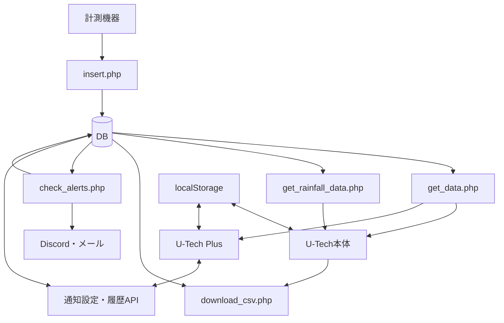

# U-Tech 引き継ぎガイド

更新日：2026年10月29日。対象はgreenhouse-iotのU-Tech本体と、共通処理を使うU-Tech Plusです。U-Tech Next・G-Flow・Yui-Techの内部実装は対象外です。

この資料はローカルのソース確認に基づきます。本番設定・DB構造の完全性・実機との対応・配送成功を保証するものではありません。パスはリポジトリのルート基準です。

## サイトの担当範囲

- **U-Tech本体**：メイン・環境スコア・データ出力・利用案内・システム情報。
- **U-Tech Plus**：アラート・分析・WBGT・過去データ・メンテ。初回はメンテ、以降は前回タブを復元します。
- 本体とPlusはパスワードなしで相互移動できます。本体からは表示へ適用済みのuser_idを引き継ぎ、Plusではタブごとに入力・保存します。
- 旧quiz機能は削除済みです。StudyHubは別リポジトリで扱います。

## ファイル構成と読み込み順

| ファイル | 担当 |
|---|---|
| `index.html` | 本体の画面・入力欄・ボタン。アプリのJavaScriptは外部ファイルです |
| `assets/utech-main.js` | 本体の初期化、メイン取得・表示、表示設定、環境スコア、雨量、CSV |
| `assets/utech-header.js` | 本体専用の日時・日の出日の入り表示、農作業こよみ、潮汐・天気取得 |
| `assets/utech-shared.js` | 共通のAPI取得・データ変換・計算・グラフ・ツールチップ同期 |
| `assets/utech.css` | 共通のヘッダー・レイアウト・入力・グラフ部品 |
| `assets/utech-main.css` | 本体専用のカード・環境スコア・CSV・表示設定 |
| `u-tech-plus/index.html` | Plusの5タブと各入力欄 |
| `u-tech-plus/assets/plus.js` | Plus専用処理、タブ別保存、初期化 |
| `u-tech-plus/assets/plus.css` | Plusの5タブとロゴ・スマホ向け補正 |
| `chart-axis-enter.js` | 縦軸入力欄のEnter操作 |

JavaScriptは次の順番で読み込みます。

- 本体：外部ライブラリ → `utech-shared.js` → `utech-header.js` → `utech-main.js` → `chart-axis-enter.js`。
- Plus：外部ライブラリ → `utech-shared.js` → `plus.js` → `chart-axis-enter.js`。
- CSSは共通を先に、サイト専用を次に読み込みます。Plus固有の補正はPlus専用CSSの末尾です。

現在はES Modulesではなく、グローバルの関数・変数を使う構成です。共通JSも各サイトの状態や関数を参照するため、読み込み順を変えたり単独で評価したりする場合は依存関係の調整が必要です。

## 読む順番

1. `index.html` と上の構成表で画面とファイルの対応を確認。
2. `assets/utech-main.js` の `DOMContentLoaded`：設定復元・イベント登録・ヘッダー取得。
3. 同ファイルの `loadData`：取得条件の作成、現在値・スコア・グラフの更新。
4. `assets/utech-shared.js` の `fetchDataSafe` → `parseData`：API取得と内部形式への変換。
5. 変更する機能の作成関数・計算関数・関連PHPを確認。
6. Plusの作業は `plus.js` の `DOMContentLoaded` → `switchPlusTab` と各タブの取得関数を確認。

## 全体の流れ



本体の天気は気象庁・Open-Meteo、潮汐は `get_tide_calendar.php` と連携します。Plusはこれらを取得しません。通知の判定・配送はサーバー側で動き、本体やPlusを閉じても保存設定は解除されません。起動スケジュールは本番環境で確認してください。

## 機能の入口

| 機能 | 主な検索語・ファイル |
|---|---|
| 画面・配置 | 本体は `index.html` と `assets/utech-main.css`、Plusは `u-tech-plus/index.html` と `u-tech-plus/assets/plus.css` |
| メイン表示 | `assets/utech-main.js`：`loadData`、`mainChartConfigs` |
| 表示・非表示、縦軸リンク | 同上：`restoreMainGraphVisibility`、`restoreMainAxisLinks` |
| 環境スコア | 同上：`getScoreRowsForPeriod`、`calcEnvironmentScoreRow` |
| 雨量・日別集計 | 同上：`loadRainfallData`、`loadTenDayRainfallSummary`、`createDailyRainfallMap`。関連PHPは `insert.php`、`get_rainfall_data.php` |
| CSV | 同上：`downloadCSV`。出力は `download_csv.php` |
| 天気・こよみ | `assets/utech-header.js`。地域変更入口は本体JSの `handleUtechAreaChange` |
| 飽差・露点 | `assets/utech-shared.js`：`calcVapor`、`calcDewPoint`。時間帯平均は本体JSの `calcVpdAverage` |
| 単一系列の描画部品 | 共通JSの `createSingleLineChart`。データ抽出・軸・期間は各呼び出し元 |
| 分析・差分 | `u-tech-plus/assets/plus.js`：`loadAnalysisCompareChart`、`calcAnalysisDiffData` |
| WBGT・黒球温度 | 同上：`calculateWbgt`、`buildWbgtSeries`、`createWbgtGlobeChart` |
| 過去データ・DIF | 同上：`loadReviewData`、`calculateReviewDif`、`loadReviewDifPeriodData` |
| メンテナンス | 同上：`loadMaintenanceData`、`getMaintenanceRange`。電圧だけ直近30日間 |
| アラート画面 | 同上：`loadActiveAlertSetting`、`saveAlertSetting` |
| 通知の保存・取得 | `save_alert_setting.php`、`get_alert_setting.php` |
| 通知の判定・配送 | `check_alerts.php`、`scripts/lib/alert-rules.php` |
| 通知の停止・履歴 | `disable_all_alerts.php`、`get_alert_history.php` |
| 縦軸Enter操作 | `chart-axis-enter.js` |

## 共通部分を変更するときの注意

- 共通JS・共通CSSは本体とPlusの両方に影響するため、両サイトで確認します。
- PlusのDIFにも必要な地域設定・日本時間変換・日の出日の入り計算は共通JSに残しています。本体専用のヘッダー表示・外部取得と区別します。
- 単一系列の共通描画は、温度・湿度・黒球温度・WBGT・汎用単一系列グラフが利用します。軸・単位・期間・警戒帯・ズームを維持してください。
- HTML内のイベント属性や動的な作成処理から呼ばれる関数もあります。単純な文字列検索だけで未使用と判断しないでください。
- CSSを移動するときは、通常指定とメディアクエリの適用順を維持します。

相互移動・タブ別user_id・保存設定の詳細は [U-Tech / Plus構成ガイド](u-tech-plus.md) を参照してください。

## 変更前に知っておく仕様

- 飽差は水蒸気量の差（g/㎥）。名前にvpdがあっても圧力の単位とは限りません。CSVにも水蒸気量の同じ式があります。
- 環境スコアは範囲内の測定件数の割合。飽差とCO2は6〜18時に限定し、総合点は欠損でない項目を同じ重みで平均します。
- WBGTの現在値は各センサーの最新値を使い、現在の前後30分以内・相互8分以内を確認します。履歴は最近傍時刻で対応付けます。FiveDayという既存名の関数は現在7日分を扱います。
- 雨量は保存済み区間雨量と、区間転倒数を換算する2方式があります。累積雨量の減少時は今回値を区間値にし、転倒数の減少時は区間値を0にします。初回の扱いも異なるため保存側コメントを確認してください。
- DIFの昼は当日日の出〜日没、夜は日没〜翌日日の出。翌朝以降に昼平均−夜平均を算出します。「確定」は十分な件数・間隔を保証しません。
- 日時の扱いは機能間で統一されていません。日本時間を明示する処理とブラウザのローカル時刻に依存する処理があります。

## CSVの契約

- 選択PointはP01〜P41、P61、P91の許可順。重複指定は除きます。
- 各ブロックは空列・日時・測定項目。P01には飽和水蒸気量・水蒸気量・飽差もあります。
- 各Point内を時刻順にし、行番号で横並びにします。同じ行が同一時刻とは限りません。
- 最大件数まで出力し、短いPointやnull値は空欄。0は保持します。0件でもヘッダーを出します。
- 画面の日付指定は開始日00:00:00〜終了日23:59:59。SQLは両端を含みます。
- UTF-8 BOM付き。P41の区間値は保存値で、画面の換算設定による再計算はしません。

## 通知の契約

- 保存対象はP01/P11の温度。aboveは以上、belowは以下で等値を含みます。
- 通常の実行対象は有効なDiscord・メール設定。最新の非null温度を使い、通常判定に鮮度の制限はありません。
- 異常通知が成功すると状態・通知日時・履歴を更新します。送信失敗では更新しません。
- 再通知待ちは前回alertで通知日時がある場合に適用します。保存APIの省略時は30分、実行側の非数値時フォールバックは180分です。
- 条件から外れて前回alertなら復帰通知。待ち時間判定より先に処理し、成功時だけnormalに更新します。失敗時はalertを維持し次回再試行します。
- 設定の更新は前回状態・通知日時をリセットしません。宛先空欄は同じ通知方式なら既存値を維持します。
- 履歴取得は利用者別の直近3日・最大50件。送信失敗一覧ではありません。
- 引数なしの `check_alerts.php` は実送信・DB更新を伴います。通常の確認では実行しないでください。診断手順は `docs/alert-diagnostics.md` を参照してください。

## 設定の保存先

localStorageは同じブラウザ・同じオリジンの保存領域で、別端末への共有ではありません。

| 保存範囲 | 主な設定 |
|---|---|
| 利用者ID別のキー | メイン表示・非表示、縦軸リンク、ガイド範囲の補助関数 |
| ブラウザ共通のキー | 外気・雨量の取得元、分析の比較元、WBGTの取得元、スコア範囲、地域、雨量換算、利用者ID履歴 |
| Plusのタブ別キー | `utechPlus_v1_{tab}` の入力条件、`utechPlus_v1_lastTab` の前回タブ |
| PHP経由でDB | 通知設定・通知履歴 |

## 検証と運用

リポジトリのルートで実行します。ブラウザ系テストにはNode.js・Playwright・Microsoft Edgeが必要です。Playwrightが通常の探索先にない場合は、そのnode_modulesを `NODE_PATH` に設定します。

| コマンド | 確認内容 |
|---|---|
| `node scripts/test-utech-plus.cjs` | 模擬APIで本体・Plusのグラフ、表示設定、相互移動、ID分離・復元、空データ、スマホ表示 |
| `node scripts/test-utech-chart-configs.cjs` | 作業ツリーとHEADのグラフ設定を36条件で比較。Node.jsとGitが必要 |
| `node scripts/test-utech-css.cjs` | 作業ツリーとHEADの静的要素のスタイルを全タブ・3画面幅の30条件で比較 |
| `node scripts/test-chart-axis-enter.cjs` | 本体とYui-Techの縦軸Enter操作。Plus専用の検証ではありません |
| `git diff --check` | 差分の余分な空白・改行など |

HEAD比較の2テストは未コミットの変更を直前のコミットと比較します。コミット後は同じ実装同士の比較になる場合があり、固定期待値による回帰テストの代わりにはなりません。ブラウザ操作テストと併用します。

構文確認の例：

```sh
node --check assets/utech-shared.js
node --check assets/utech-header.js
node --check assets/utech-main.js
node --check u-tech-plus/assets/plus.js
```

`scripts/test-alert-user-id.cjs` と `scripts/test-alert-setting-time.cjs` は本体HTMLから関数を抽出する旧構成のテストです。Plus分離後の構成への追従が必要で、現在の合格判定には使用していません。

主要ブラウザテストはローカルの模擬APIを使い、本番DBや通知配送は検証しません。通知のPHPテスト・診断は [アラート診断](alert-diagnostics.md)、本番反映は [反映手順](production-deploy.md) を参照してください。プッシュと本番反映は別の手順です。

変更ごとの確認範囲：

- 本体専用処理：メイン、スコア、CSV、表示設定、PC・スマホ。
- 共通グラフ：上記に加え、Plusの分析・WBGT/P51・過去データ・メンテ、ズーム・縦軸・データなし表示。
- 地域・日時：本体の天気・こよみと、PlusのDIF。日付境界や日本以外のブラウザ時刻にも注意。
- API・DB・通知：対象PHPの契約と専用テストを確認。通常の通知処理を検証代わりに起動しないでください。

## 未確認事項と保留事項

- 各計算式・判定閾値の出典、採用理由、適用範囲。
- Pointと実機の対応、単位・校正・送信間隔。
- 本番のDB定義・索引・時刻設定、バックアップと復旧手順。
- 通知の実行スケジュール・管理担当・実際の配送結果。
- 匿名化した検証用データと期待結果。
- 分離前に報告されたズーム直後のChart.jsエラーは調査保留です。表示ボタンで復旧したとの報告があり、現在の分離構成での再現性・原因は未確認です。

秘密情報の実値は資料に記載しません。接続設定の配置・項目と管理方法を引き継ぎ時に確認してください。
