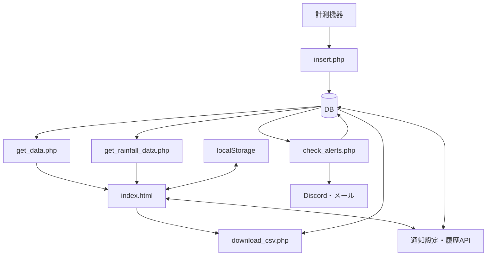

# U-Tech 引き継ぎガイド

更新日：2026年10月26日。対象はgreenhouse-iotのU-Tech本体。U-Tech Next・G-Flow・Yui-Techの内部実装は対象外です。

この資料はローカルのソース確認に基づきます。本番設定・DB構造の完全性・実機との対応・配送成功を保証するものではありません。パスはリポジトリのルート基準です。

## 読む順番

1. `index.html` 冒頭の案内と「===」の機能見出し。
2. `DOMContentLoaded`：設定復元・イベント登録・初期情報取得。
3. `switchTab`：タブ切替時の取得条件。
4. `loadData` → `fetchDataSafe` → `parseData`：メインの測定値取得・変換・描画。
5. 調整する機能の計算関数と関連PHP。

## 全体の流れ

天気は気象庁・Open-Meteo、潮汐は `get_tide_calendar.php` と連携します。通知の起動スケジュールは本番環境で別途確認してください。

## 機能の入口

| 機能 | 主な検索語・ファイル |
|---|---|
| メイン表示 | `loadData`、`mainChartConfigs`、`create…Chart` |
| 分析・差分 | `loadAnalysisCompareChart`、`calcAnalysisDiffData` |
| 飽差・露点 | `calcVapor`、`calcDewPoint`、`calcVpdAverage` |
| 環境スコア | `getScoreRowsForPeriod`、`calcEnvironmentScoreRow` |
| WBGT | `calculateWbgt`、`renderWbgtCurrent`、`buildWbgtSeries` |
| 雨量 | `insert.php`、`get_rainfall_data.php`、`loadRainfallData` |
| 日別雨量 | `loadTenDayRainfallSummary`、`createDailyRainfallMap` |
| 過去データ・DIF | `loadReviewData`、`createReviewDifBoundaries`、`calculateReviewDif` |
| 7日DIF | `loadReviewDifPeriodData`、`calculateReviewDifPeriodRows` |
| メンテナンス | `loadMaintenanceData`、`getMaintenanceRange` |
| CSV | `downloadCSV`、`download_csv.php` |
| 通知の保存・取得 | `save_alert_setting.php`、`get_alert_setting.php` |
| 通知の判定・配送 | `check_alerts.php`、`scripts/lib/alert-rules.php` |
| 通知の停止・履歴 | `disable_all_alerts.php`、`get_alert_history.php` |
| 縦軸Enter操作 | `chart-axis-enter.js` |

## 変更前に知っておく仕様

- 飽差は水蒸気量の差（g/㎥）。名前にvpdがあっても圧力の単位とは限りません。CSVにも水蒸気量の同じ式があります。
- 環境スコアは範囲内の測定件数の割合。飽差とCO2は6〜18時に限定し、総合点は欠損でない項目を同じ重みで平均します。
- WBGTの現在値は各センサーの最新値を使い、現在の前後30分以内・相互8分以内を確認します。履歴は最近傍時刻で対応付けます。FiveDayという既存名の関数は現在7日分を扱います。
- 雨量は保存済み区間雨量と、区間転倒数を換算する2方式があります。累積雨量の減少時は今回値を区間値にし、転倒数の減少時は区間値を0にします。初回の扱いも異なるため保存側コメントを確認してください。
- DIFの昼は当日日の出〜日没、夜は日没〜翌日日の出。翌朝以降に昼平均−夜平均を算出します。「確定」は十分な件数・間隔を保証しません。
- 日時の扱いは機能間で統一されていません。日本時間を明示する処理とブラウザのローカル時刻に依存する処理があります。

## CSVの契約

- 選択PointはP01〜P41、P61、P91の許可順。重複指定は除きます。
- 各ブロックは空列・日時・測定項目。P01には飽和水蒸気量・水蒸気量・飽差もあります。
- 各Point内を時刻順にし、行番号で横並びにします。同じ行が同一時刻とは限りません。
- 最大件数まで出力し、短いPointやnull値は空欄。0は保持します。0件でもヘッダーを出します。
- 画面の日付指定は開始日00:00:00〜終了日23:59:59。SQLは両端を含みます。
- UTF-8 BOM付き。P41の区間値は保存値で、画面の換算設定による再計算はしません。

## 通知の契約

- 保存対象はP01/P11の温度。aboveは以上、belowは以下で等値を含みます。
- 通常の実行対象は有効なDiscord・メール設定。最新の非null温度を使い、通常判定に鮮度の制限はありません。
- 異常通知が成功すると状態・通知日時・履歴を更新します。送信失敗では更新しません。
- 再通知待ちは前回alertで通知日時がある場合に適用します。保存APIの省略時は30分、実行側の非数値時フォールバックは180分です。
- 条件から外れて前回alertなら復帰通知。待ち時間判定より先に処理し、成功時だけnormalに更新します。失敗時はalertを維持し次回再試行します。
- 設定の更新は前回状態・通知日時をリセットしません。宛先空欄は同じ通知方式なら既存値を維持します。
- 履歴取得は利用者別の直近3日・最大50件。送信失敗一覧ではありません。
- 引数なしの `check_alerts.php` は実送信・DB更新を伴います。通常の確認では実行しないでください。診断手順は `docs/alert-diagnostics.md` を参照してください。

## 設定の保存先

localStorageは同じブラウザ・同じオリジンの保存領域で、別端末への共有ではありません。

| 保存範囲 | 主な設定 |
|---|---|
| 利用者ID別のキー | メイン表示・非表示、縦軸リンク、ガイド範囲の補助関数 |
| ブラウザ共通のキー | 外気・雨量の取得元、分析の比較元、WBGTの取得元、スコア範囲、地域、雨量換算、利用者ID履歴 |
| PHP経由でDB | 通知設定・通知履歴 |

## 検証と運用

コメント整理では、追加コメントを除いたバイト列が元ファイルと完全一致すること、JS/PHP構文と `git diff --check` を確認しています。ブラウザ・実データの確認は別途必要です。

既存の確認資産：

- `scripts/test-chart-axis-enter.cjs`：縦軸Enter操作（Playwrightが必要）。
- `scripts/test-alert-user-id.cjs`：通知画面の利用者切替など。
- 通知のPHPテストと実行方法：`docs/alert-diagnostics.md`。
- 本番反映の操作・失敗時確認：`docs/production-deploy.md`。プッシュと本番反映は別の手順です。

ファイル分割時は、HTMLから関数ソースを抽出するテスト、グローバル変数、HTML内onclick、スクリプト実行順への影響も確認します。

## 未確認事項と保留事項

- 各計算式・判定閾値の出典、採用理由、適用範囲。
- Pointと実機の対応、単位・校正・送信間隔。
- 本番のDB定義・索引・時刻設定、バックアップと復旧手順。
- 通知の実行スケジュール・管理担当・実際の配送結果。
- 匿名化した検証用データと期待結果。
- ズーム直後のChart.jsエラーは調査保留。表示ボタンで復旧したとの利用者報告があり、原因は未確定です。

秘密情報の実値は資料に記載しません。接続設定の配置・項目と管理方法を引き継ぎ時に確認してください。
